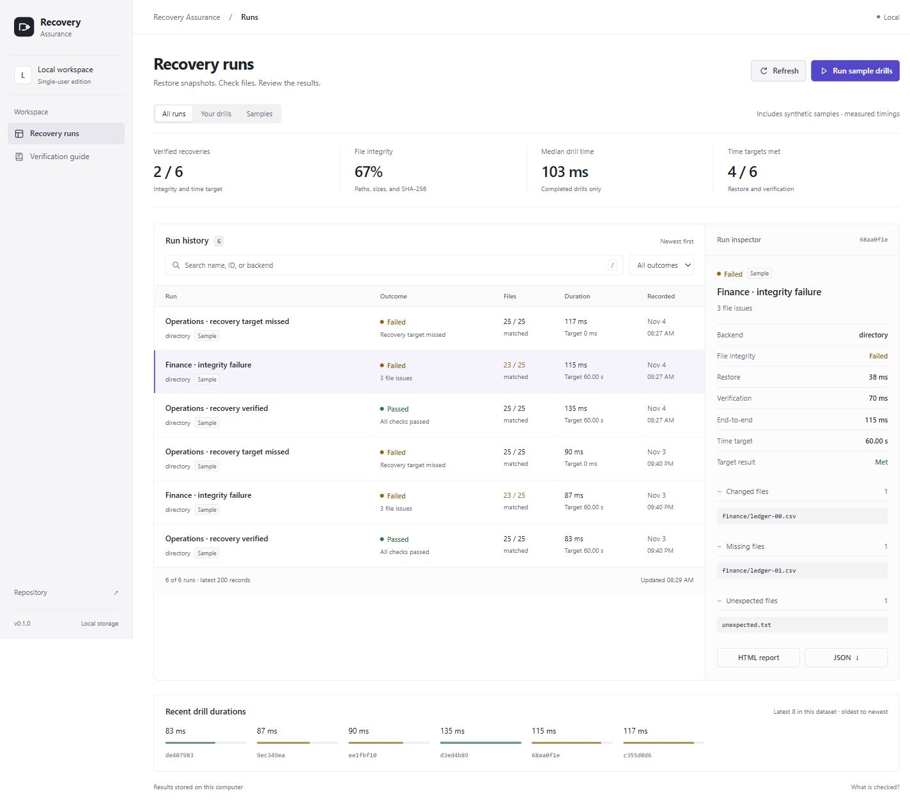

# Recovery Assurance

Run isolated file-recovery drills, compare restored content with a saved baseline, and record whether integrity and recovery-time targets passed. Built with Python, FastAPI, SQLite, and plain browser modules.



The screenshot shows synthetic sample drills with measured restore and verification timings.

## What works today

- **Real restore drills:** directory snapshots and a restic adapter, including snapshot subfolders.
- **Content integrity:** relative paths, byte sizes, and streaming SHA-256; catches same-size corruption, missing files, and unexpected files.
- **Recovery-time objectives:** separate restore and verification timings, with an end-to-end target that also includes temporary-directory setup and cleanup. A run passes only when both integrity and time pass.
- **Persistent evidence:** SQLite history, a baseline fingerprint, the resolved restic snapshot ID, JSON exports, and standalone HTML reports suitable for printing.
- **Local operations dashboard:** a searchable run list, dataset and outcome filters, a persistent evidence inspector, and measured duration comparisons.
- **Reproducible demo:** creates synthetic files and executes three actual drills: healthy recovery, integrity failure, and a deliberately impossible zero-second target. Timings are measured, never prefilled.
- **Automation-ready CLI:** exit codes suitable for scheduled tasks and CI.

## Quick start

Requires **Python 3.12+**. No cloud account, credentials, or restic installation is required for the local demo.

```powershell
git clone https://github.com/marcusdiccox/recovery-assurance.git
cd recovery-assurance
python -m venv .venv
# Windows PowerShell; activation is optional
.venv\Scripts\python -m pip install -r requirements.txt
.venv\Scripts\python -m pip install --no-deps -e .
.venv\Scripts\python -m recovery_assurance demo
.venv\Scripts\python -m recovery_assurance serve
```

Open **http://127.0.0.1:8765**. The dashboard also has a **Run sample drills** button; each click appends three new measured records.

Select a run to inspect its file checks and timings, or download its HTML/JSON report. Press `/` to search. The summary describes the selected dataset; search and outcome filters narrow the history list. See [interface notes and references](docs/interface.md) for the design decisions.

On Linux/macOS, replace `.venv\Scripts\python` with `.venv/bin/python`.

## Test your own directory snapshot

Use stable test data. Capture a baseline **at the time the backup snapshot is created**, and store the manifest outside the source and backup directories. Reusing a baseline from different data will correctly report differences.

Baseline files use UTF-8 JSON, with or without a BOM, and integer `schema_version: 1`. Duplicate keys at any level, including repeated file paths or checksum fields, are rejected. A rejected baseline returns exit code **2** before restoring files or appending run evidence.

Optional per-file annotations are preserved and included in the baseline fingerprint. Content verification compares each path's required byte size and SHA-256, so annotations such as an operator note do not make unchanged files fail. Annotation values are not checks of restored ownership, permissions or other filesystem metadata.

Baseline saves create a new file exclusively. Handled serialization, write or close failures remove the new partial output when its file identity can be verified; existing destinations and replaced paths are left alone. Cleanup errors are reported. Missing file identity or abrupt termination can still leave output to inspect, so use a baseline only after capture succeeds.

```powershell
recovery-assurance capture ./source --manifest ./baseline-2026-11-03.json
# Create your backup snapshot separately; this tool does not schedule backups.
recovery-assurance drill --manifest ./baseline-2026-11-03.json --backup ./backup-snapshot --name "Operations files" --rto-seconds 60
recovery-assurance serve
```

The `directory` backend copies the snapshot into a fresh temporary directory, verifies it, and cleans up. It never restores over your original source. It tests a directory copy, not a backup format or cloud recovery.

| Exit code | Meaning |
|---|---|
| `0` | Drill passed; other commands completed successfully |
| `1` | Drill failed an objective, or a saved-evidence health check is unhealthy |
| `2` | Configuration, restore, verification, or command error |
| `75` | Requested drill lock is held; this invocation skipped without starting a drill |

`recovery-assurance list` prints the latest 200 records by default. Continue with `list --before LAST_RUN_ID`, using the final record's `id` from the previous page, until an empty list is returned. Keep the same `--dataset` filter when paging; see [history traversal](docs/datasets.md#review-a-datasets-history). Use `--db ./data/custom.db` on drill, run, check, check-many, demo, list, datasets, export, backup-history, and serve commands to select another database.

Listing an existing history file uses read-only access, including filtered and paged reads. Prepared write-protected archives can be inspected without changing their schema or journal mode. A missing history path retains first-use setup: it creates an empty database and prints `[]`. An existing empty or unrelated file returns exit code **2** instead of being initialized as history.

## Repeat a named dataset

Keep baseline and backup settings in a private configuration, then run a selected profile:

```sh
recovery-assurance run ./datasets.local.json --dataset documents-directory --db ./data/runs.db
```

Local backup and manifest paths resolve relative to the configuration file, so the drill selects the same inputs when a scheduler uses another working directory. The original `drill` command remains available. See [dataset configuration](docs/datasets.md) and the [example template](examples/datasets.example.json).

Profile keys are saved as dataset labels in evidence. Use `recovery-assurance list --dataset documents-directory --db ./data/runs.db` to review that dataset's latest 200 records. Direct drills can opt in with `--dataset`; older and unlabelled records remain in combined history.

See the [host scheduling runbook](docs/scheduling.md) for Windows Task Scheduler and Linux cron recipes, local overlap controls, account/path setup, exit-code handling and evidence checks.

To coordinate scheduled and manual invocations on one host, add `--lock-file ./data/documents.lock` to `run` or `drill`. Every invocation for that workload must use the same path. The optional guard acquires a nonblocking OS lock before opening history or validating drill inputs; contention returns **75**, prints a skip reason to stderr, and records no run. Normal drill outcomes retain codes **0/1/2**. The path is relative to the working directory, so use an absolute path in schedulers.

Use a dedicated new or empty local file ending in `.lock`; symlinks, nonempty files and history/SQLite-sidecar aliases are rejected. Parent directories are created if needed. The file stays in place and contains no PID or credentials; the OS lock is released when its holder closes or exits. Keep it in a trusted local directory and do not delete or replace it while invocations may be active. This coordinates cooperating CLI invocations, not other hosts or calls that omit the option.

## List recorded datasets

Discover labels already present in real drill history:

```sh
recovery-assurance datasets --db ./data/runs.db
```

The JSON list is sorted by exact label and contains `dataset`, `run_count`, `latest_run_id`, `latest_started_at` and `latest_status`. Counts include passed, failed and error records across the entire history, beyond the 200-row history page. Latest uses stored start time descending, then run ID descending for ties. Labels are case-sensitive and are not normalized.

Only string labels without NUL and an explicit JSON `sample: false` marker count; unlabelled, synthetic and unmarked legacy records remain available through combined history. This is a read-only inventory of saved evidence, not a registry of configured profiles or a health assessment. Datasets without recorded real evidence are absent. Use `list --dataset LABEL` to inspect a grouping, `check` to assess freshness/outcome, or `export` with its recorded run ID.

Readable empty history returns `[]` and exit **0**; recorded failures do not change the inventory command's exit code. Missing/unusable history returns **2** with stderr and no JSON. Missing paths are not created, existing history is not initialized or converted, and the same SQLite WAL access requirements as other read-only commands apply. See [dataset discovery](docs/datasets.md#discover-recorded-datasets).

## Check saved evidence for monitoring

Check whether one dataset has a recent passing real drill without performing another restore:

```sh
recovery-assurance check --dataset finance --max-age-hours 25 --db ./data/runs.db
```

Choose a finite positive age limit for your own schedule; 25 hours is an example policy with an hour of margin for a daily drill. The command prints JSON with `healthy`, `reasons`, `dataset`, `max_age_hours`, `run_id`, `run_status`, `finished_at` and `age_hours`, plus `schema_version: 1`. Exit **0** means the selected evidence is fresh and passed; **1** means `no_evidence`, `stale`, `latest_run_failed` or `latest_run_error` (reasons can combine). An assessment without evidence has null run/time fields. Exit **2** means the check could not assess health, such as missing/unreadable history, an invalid age policy or unusable latest-run metadata; errors go to stderr without JSON.

Selection uses the exact dataset label and requires JSON `sample: false`; synthetic demos and records without that explicit marker do not count. Filtering happens before selecting one row, so unrelated or sample activity cannot hide real evidence. The newest run is determined by stored start time descending, then run ID descending, as in history. A newer failure/error is not replaced by an older success. Age uses timezone-aware `finished_at`; exactly the age limit is still fresh. Reversed, future or missing timestamps, contradictory passing flags and decoded dataset/sample metadata that disagrees with selection return **2**, rather than healthy evidence. Keep host clocks synchronized.

Existing history is opened read-only without initialization or journal conversion; a missing path is an error and is not created. SQLite WAL sidecar/access requirements still apply. This checks recorded evidence, not whether a scheduler launched, whether a drill is currently running, backup freshness/RPO or application recovery. An attempt that produced no evidence is only detectable here once saved evidence exceeds the chosen age limit. No alerts or monitoring service are installed; a host monitoring script can consume the exit code and JSON.

To also require evidence for a particular baseline, pass its manifest:

```sh
recovery-assurance check --dataset finance --max-age-hours 25 --manifest ./baseline.json --db ./data/runs.db
```

The check reads and validates the manifest, then compares its canonical SHA-256 with the latest real run's `baseline_sha256`. A different valid fingerprint adds `baseline_mismatch` and returns **1**, even when that run is fresh and passed. It does not search for an older matching run. Age and outcome requirements still apply, and absent real evidence remains `no_evidence`.

With `--manifest`, JSON also includes `expected_baseline_sha256` and the recorded `baseline_sha256` (null without evidence). A missing or malformed recorded fingerprint, or an unreadable/invalid manifest, returns **2** with stderr and no JSON. Without the option, the existing assessment and JSON fields are unchanged, including support for legacy evidence without a fingerprint.

The fingerprint covers the entire parsed manifest, including `created_at` and annotations; JSON whitespace, key order and a UTF-8 BOM do not affect it. Supply the saved baseline revision you expect, rather than capturing a new one for each probe. Relative manifest paths use the working directory; use an absolute path in monitoring jobs. Neither the baseline nor history is modified, and no restore is performed. This compares saved metadata, which is not signed; it does not authenticate an editable archive or verify that the backup still exists. The option applies to single-dataset `check`; use a separate check for each dataset that needs its own baseline policy.

To require several datasets in one monitoring probe, supply each expected label explicitly:

```sh
recovery-assurance check-many --dataset finance --dataset operations --max-age-hours 25 --db ./data/runs.db
```

Its JSON contains `schema_version: 1`, combined `healthy`, `max_age_hours` and a `results` list of ordinary single-dataset assessments. Exact duplicate labels are checked once, in first-occurrence order; case remains significant. Exit **0** requires every supplied label to be healthy. Exit **1** means at least one valid assessment is unhealthy, including a label with no real evidence. Exit **2** means any assessment could not be completed; no partial JSON success is printed. An empty API selection is rejected. The existing `check` command and JSON format are unchanged.

Choose the required labels from your operational policy; automatically selecting only discovered datasets would miss workloads that have never produced evidence. Checks read live history sequentially, without a single cross-dataset snapshot. This does not install a scheduler, registry or alert service, and retains the single-check timestamp, sample and archive requirements.

## Export saved evidence from the CLI

Export a recorded run without starting the dashboard or repeating the restore. Replace `RUN_ID` with the `id` printed by a drill or `list`:

```sh
recovery-assurance export RUN_ID --output ./data/report.json
recovery-assurance export RUN_ID --format html --output ./data/report.html
```

JSON is the default; `--format` selects the format regardless of the filename. Both formats retain the stored outcome, dataset label, baseline fingerprint, and snapshot evidence where present. HTML uses the same standalone, escaped report as the dashboard and can be printed from a browser. Exporting a failed or error run succeeds with exit code **0**; it does not change the drill's recorded outcome or append another run.

The output file must be new and its parent directory must already exist. Existing files are never overwritten. Unknown run IDs, missing or invalid databases, and output errors return **2**. Use `--db` to select existing history; relative database and output paths use the shell's working directory. Keep real exports private: reports can contain filenames and dataset labels. The example paths above stay under Git-ignored `data/`.

Listing an existing database and exporting a report open the source read-only, without initializing its schema or changing its journal mode. Readable archives can therefore be inspected even when the database file is write-protected. For an archive on read-only media, prepare a consistent SQLite snapshot in rollback-journal (`DELETE`) mode before locking it down. WAL histories retain SQLite's [sidecar requirements](https://www.sqlite.org/wal.html#read_only_databases): existing readable `-wal`/`-shm` files or permission to create them may be needed. Do not separate a live database from its WAL when making an archive. These reads do not convert or repair history.

## Back up run history

Create a consistent SQLite copy of the entire history database, including committed records still in its WAL. This uses [SQLite's online backup API](https://www.sqlite.org/backup.html), independently of the history list's 200-record limit:

```sh
recovery-assurance backup-history --db ./data/runs.db --output ./data/history-2026-11-12.db
recovery-assurance export RUN_ID --db ./data/history-2026-11-12.db --output ./data/archived-report.json
```

Choose a new output filename and an existing parent directory. Existing files, including the source database and symlink destinations, are rejected. The source is opened read-only; only the copy is finalized in rollback-journal (`DELETE`) mode so it can be used as a standalone archive. The command preserves all database contents and does not rerun drills, delete old records, or back up the source files tested by those drills. Keep history archives private: they contain report paths, labels, and any other tables stored in that database. The example paths stay under Git-ignored `data/`.

Source and output names must not overlap SQLite companion filenames (`-journal`, `-wal`, or `-shm`). Existing output companion paths, including dangling symlinks, are also rejected before creating the archive. Choose a different basename if one of these paths is already present.

Exit code **0** means the archive is ready; ordinary errors return **2**. Copy progress has a 15-second budget, with SQLite connection waits applying separately. Handled copy failures remove the newly created partial output. Abrupt process termination can leave an incomplete file, so use an archive only after a successful command. No automatic retention, repair, scheduling, or external storage is configured.

## Test a restic backup

Install [restic](https://restic.net/) separately. Credentials remain in restic's environment or password-file configuration. They are not stored in reports.

```powershell
$env:RESTIC_PASSWORD_FILE = "C:\private\restic-password.txt"
recovery-assurance drill --backend restic --backup "C:\backups\restic-repo" --snapshot "SNAPSHOT_ID:/C/data/source" --manifest ./baseline.json --name "Restic recovery" --rto-seconds 120 --timeout 600
```

Replace `SNAPSHOT_ID` and the subfolder with the actual values from `restic snapshots` and `restic ls SNAPSHOT_ID`. On Linux, a subfolder might be `/home/marcus/source`. Restic restores full absolute paths by default; selecting `ID:/subfolder` puts that subfolder's contents at the verification root.

Each restic drill resolves the selector once and restores that exact full ID, preserving the subfolder. Reports retain the requested selector in `snapshot` and the immutable ID in `resolved_snapshot`; a newer backup appearing during the drill cannot change its restore selection. For repeatability across separate drills, prefer a full ID to `latest`. Lookup and restore share the `--timeout` budget. See the [restic runbook](docs/restic-runbook.md).

## Docker

```sh
docker build -t recovery-assurance .
docker run --rm -p 127.0.0.1:8765:8765 -v recovery-evidence:/data recovery-assurance
```

The container runs as a non-root user. The image includes the dashboard and local sample drills; restic is not bundled. Docker commands are provided for reproducibility; see [validation](docs/validation.md) for checks actually run.

## Engineering

```sh
python -m pip install -r requirements-dev.txt
python -m pip install --no-deps -e .
python -m pytest -q
node --test tests/dashboard.test.mjs
python -m ruff check .
python -m ruff format --check .
python -m build
```

CI runs on Windows and Ubuntu and installs a pinned restic release for the actual backup/restore integration test. The integration test skips locally if restic is absent; ordinary demo, API, and CLI tests still run.

- [Architecture and tradeoffs](docs/architecture.md)
- [Recovery drill runbook](docs/restic-runbook.md)
- [Validation and limitations](docs/validation.md)
- [Roadmap](docs/roadmap.md)

## Boundaries

This is a **local, single-user engineering project**, not a production disaster-recovery service. The server binds to loopback and validates hostnames; it has no login or multi-user authorization. Do not expose it publicly. The browser can trigger only synthetic sample drills; real targets are configured through the CLI.

Verification covers regular-file content and paths, not permissions, file metadata, empty directories, application startup, database consistency, or recovery-point objectives. Symlinks and junctions are rejected. Use stable snapshots; concurrent changes are unsupported. Reports are append-only through the application, but SQLite is not a signed or tamper-proof audit log. Preserve baseline manifests separately; the fingerprint identifies a baseline and does not establish its trustworthiness.

No Azure resources are provisioned by this repository. Cloud identity, scheduling, storage, and telemetry integrations are future work, documented explicitly in the roadmap.
