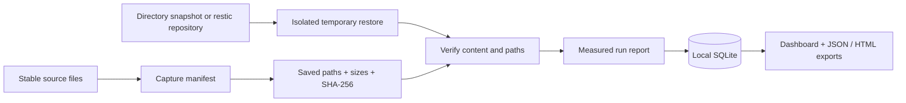

# Architecture

## Data flow

## Modules

| Module | Responsibility |
|---|---|
| `core.py` | Baseline validation, streaming hashes, backend invocation, comparison, timings |
| `storage.py` | Parameterized, append-only SQLite inserts and bounded history reads |
| `demo.py` | Synthetic fixtures and genuine successful / failed recovery drills |
| `cli.py` | Capture, drill, list, demo, and loopback server commands |
| `web.py` | Read APIs, local sample drill action, report downloads, static assets |
| `reports.py` | Escaped, self-contained HTML evidence |
| `static/` | Dependency-free dashboard, accessible controls, native dialogs, SVG chart |

## Design decisions

**Saved baselines rather than the current source.** The expected state must represent the backed-up data. Hashing today's live source after restoring last week's backup would confuse ordinary changes with corruption. Each report records the baseline's canonical-JSON SHA-256.

**All checks must pass.** A fast restore with changed files fails. A correct restore outside its objective fails. A failed backend is an error record, never a successful empty comparison. Empty manifests cannot establish recovery success.

**Temporary restore destinations.** Every drill gets a fresh directory; original data is not overwritten. Temporary files are removed before a successful run is finalized. The end-to-end timer includes cleanup and excludes report persistence.

**A boring local stack.** Python, FastAPI, SQLite, and plain JavaScript keep the first version easy to run and inspect. SQLite uses per-operation connections and WAL. There is no frontend build service or third-party analytics.

**Narrow browser authority.** Real filesystem paths and backup credentials are not browser inputs. The demo mutation requires an explicit header and same-origin requests. Trusted hosts and a restrictive dashboard CSP reduce exposure; these controls do not replace authentication for a future hosted service.

**Restic is a subprocess boundary.** Arguments are passed without a shell; credentials come from the environment. The subprocess has a timeout and no interactive stdin. Raw output is suppressed so reports cannot inadvertently retain credential-bearing URLs or environment details. Inspect restic directly when diagnosing failures.

## Evidence contract

A report records its ID, UTC timestamps, baseline hash, backend, requested snapshot identifier for restic, sample-data flag, objective, measured durations, integrity result, comparison counts and paths, outcome, and a sanitized error category. When `latest` is requested, the report identifies the selector as `latest`, not a resolved immutable snapshot ID; use a full ID for defensible evidence.

Stored report JSON is not cryptographically signed. The application has no update/delete route, but anyone with filesystem access can alter the database. Filenames in reports may themselves be sensitive: use synthetic data for portfolio screenshots.
