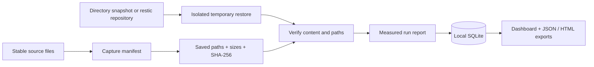

# Architecture

## Data flow

## Modules

| Module | Responsibility |
|---|---|
| `core.py` | Baseline validation, streaming hashes, backend invocation, comparison, timings |
| `storage.py` | Parameterized SQLite inserts, bounded history reads, optional read-only connections, and consistent history copies |
| `demo.py` | Synthetic fixtures and genuine successful / failed recovery drills |
| `cli.py` | Capture, direct/profile drills, list, saved-evidence export, history backup, demo, and loopback server commands |
| `config.py` | Versioned named profiles, strict field validation, and config-relative local paths |
| `web.py` | Read APIs, local sample drill action, report downloads, static assets |
| `reports.py` | Escaped, self-contained HTML evidence |
| `static/` | Dependency-free dashboard, accessible controls, native dialogs, SVG chart |

## Design decisions

**Saved baselines rather than the current source.** The expected state must represent the backed-up data. Hashing today's live source after restoring last week's backup would confuse ordinary changes with corruption. Each report records the baseline's canonical-JSON SHA-256.

**Unambiguous baseline input.** The manifest loader rejects duplicate JSON keys in every object before they can replace file paths, sizes, or checksums. This also covers keys that decode to the same string through JSON escapes. Schema version must be the integer `1`; boolean and floating-point lookalikes are invalid. UTF-8 input may include a BOM, and the parsed manifest supplies the existing canonical fingerprint. Direct and named-profile CLI drills validate the baseline before starting a restore or appending run evidence.

**All checks must pass.** A fast restore with changed files fails. A correct restore outside its objective fails. A failed backend is an error record, never a successful empty comparison. Empty manifests cannot establish recovery success.

**Temporary restore destinations.** Every drill gets a fresh directory; original data is not overwritten. Temporary files are removed before a successful run is finalized. The end-to-end timer includes cleanup and excludes report persistence.

**A boring local stack.** Python, FastAPI, SQLite, and plain JavaScript keep the first version easy to run and inspect. SQLite uses per-operation connections and WAL. There is no frontend build service or third-party analytics.

**Narrow browser authority.** Real filesystem paths and backup credentials are not browser inputs. The demo mutation requires an explicit header and same-origin requests. Trusted hosts and a restrictive dashboard CSP reduce exposure; these controls do not replace authentication for a future hosted service.

**Restic is a subprocess boundary.** Arguments are passed without a shell; credentials come from the environment. Snapshot lookup and restore share a timeout and have no interactive stdin. Lookup JSON is validated in memory and only its full snapshot ID is retained. Restore output and stderr are suppressed so reports do not retain raw credential-bearing URLs or environment details. Inspect restic directly when diagnosing failures.

## Evidence contract

A report records its ID, UTC timestamps, baseline hash, backend, requested snapshot identifier for restic, sample-data flag, objective, measured durations, integrity result, comparison counts and paths, outcome, and a sanitized error category. The additive `resolved_snapshot` field records the immutable full ID selected before restore; `snapshot` continues to record the requested selector. The resolved ID is used for the restore itself, not looked up again. It is retained on a later restore failure, and is `null` when resolution failed or the backend is a directory. Existing stored reports remain readable without migration.

Stored report JSON is not cryptographically signed. The application has no update/delete route, but anyone with filesystem access can alter the database. Filenames in reports may themselves be sensitive: use synthetic data for portfolio screenshots.

The CLI `export` command retrieves a saved report by ID and writes JSON or the existing standalone HTML rendering as UTF-8. It serializes before exclusively creating the destination, refuses existing files, and does not append or modify run evidence. It requires an existing database and output parent directory. This supports local evidence collection without starting an HTTP server; it does not schedule or deliver reports to an external service.

`Store(path, read_only=True)` skips directory, table, and journal initialization and uses an escaped absolute file URI with SQLite `mode=ro`. CLI export and history backup select this mode; other commands retain the existing writable default. Reads preserve SQLite locking and committed WAL visibility rather than assuming an immutable database. Inserts through a read-only store fail at the SQLite boundary, and opening a missing database cannot create it. Read-only WAL access still follows SQLite's sidecar requirements, as documented in the README.

`backup-history` also selects read-only source access. `Store.backup_to(output)` rejects source/output sidecar-name overlap in either direction and pre-existing destination companions, including dangling links, before creating output. Native path-name comparison and parent-directory identity account for Windows casing and directory aliases. The method checks the runs table, exclusively creates a new destination, and calls SQLite's backup API in 128-page steps with a 15-second progress budget. It copies the entire database, including committed WAL content, and switches only the destination to `DELETE` journal mode. Connections close before success is returned; handled copy failures remove the new partial destination, while pre-existing paths are never removed. This is a local evidence archive, not a backup of the files referenced by evidence or an automatic retention policy.

Named profiles save their key in the additive `dataset` field; direct drills can provide the same label. `Store.list(dataset=...)`, CLI history, and the read API apply an exact parameterized filter before the history limit using SQLite's JSON extraction. Old rows need no migration: absent or null labels remain unassigned and appear in unfiltered history. A dataset label links historical baseline fingerprints and resolved snapshot IDs, but it is not a separate catalog or a uniqueness guarantee across configuration files.

History reads also accept `before=RUN_ID` (`list --before` in the CLI). `Store.list` looks up the anchor's stored timestamp and ID, then applies a bound [SQLite row-value comparison](https://www.sqlite.org/rowvalue.html) before the page limit. Both sorting and the boundary use `(started_at DESC, id DESC)`, so equal timestamps have a deterministic order. Dataset filtering is combined with the cursor predicate. A missing anchor raises `HistoryCursorNotFound`, a ValueError subclass mapped to CLI exit 2 and API 404; other read errors retain their existing handling. This adds no schema migration and preserves the default 200-record JSON list. Pages follow live history rather than holding a transaction across requests.
